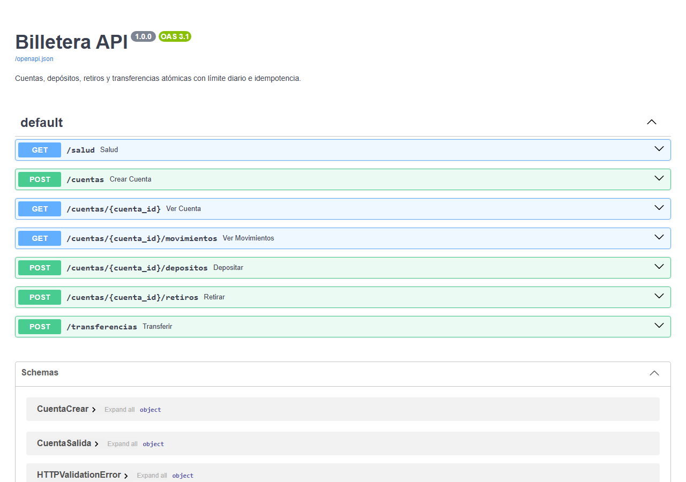

# Wallet API

> [Versión en español](README.md)



REST API for a digital wallet: accounts in BOB or USD, deposits, withdrawals and **atomic transfers**, with **daily limits**, **idempotency** and an immutable movement ledger.

## Why it is interesting
Handling money has classic pitfalls. This project addresses them:
- **No rounding errors:** money is stored as **integer cents**, never as `float` (0.10 + 0.20 is exactly 0.30).
- **Atomic transfers:** debit and credit happen in one transaction; if anything fails, no balance changes.
- **Idempotency:** retrying a transfer with the same `Idempotency-Key` header (for example after a network drop) never charges twice.
- **Concurrency:** rows are locked with `SELECT … FOR UPDATE` (on PostgreSQL), always in the same order, to prevent deadlocks.
- **Business rules:** balance never negative (also enforced as a database constraint), same currency for transfers, daily limit of 5,000 on outgoing money.

## Stack
Python 3.12, FastAPI, SQLAlchemy 2, Pydantic 2, SQLite or PostgreSQL, pytest. Dockerfile included.

## Run it
```bash
pip install -r requirements.txt
uvicorn app.main:app --reload     # http://localhost:8000/docs
pytest -q                         # 11 tests
```

## Endpoints
| Method | Path | Description |
|---|---|---|
| POST | `/cuentas` | Create an account (`titular`, `moneda`: BOB or USD) |
| GET | `/cuentas/{id}` | Balance and details |
| GET | `/cuentas/{id}/movimientos` | Ledger, newest first, paginated |
| POST | `/cuentas/{id}/depositos` | Deposit |
| POST | `/cuentas/{id}/retiros` | Withdrawal (checks balance and daily limit) |
| POST | `/transferencias` | Transfer; optional `Idempotency-Key` header |

Identifiers and messages are in Spanish (`cuentas` = accounts, `transferencias` = transfers).

MIT License.
